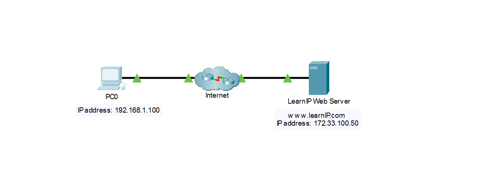
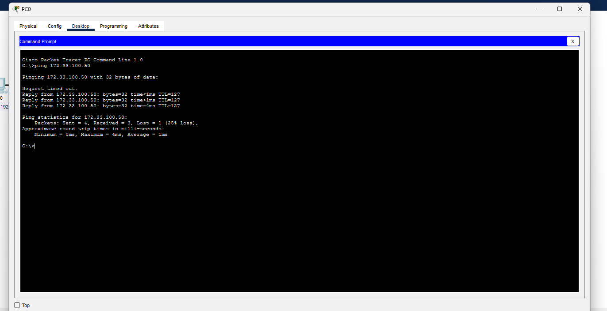
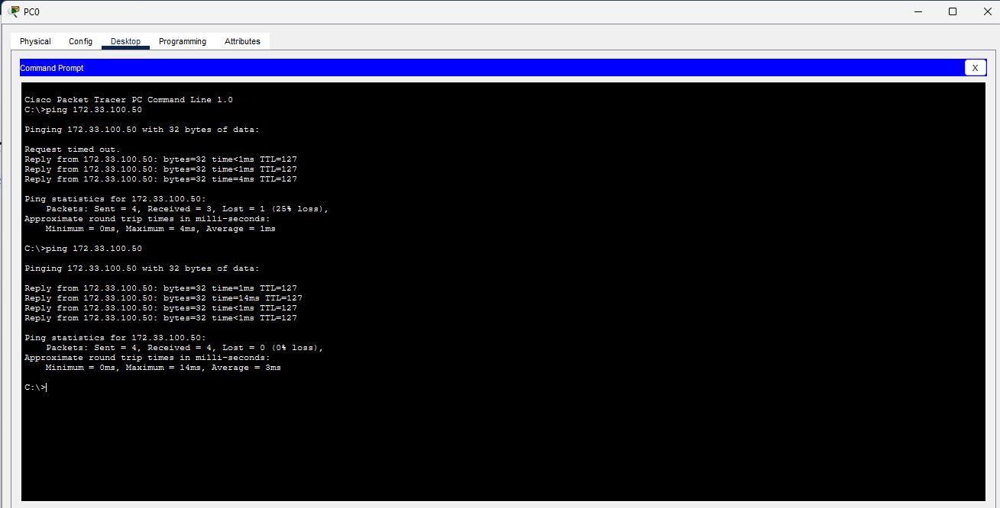
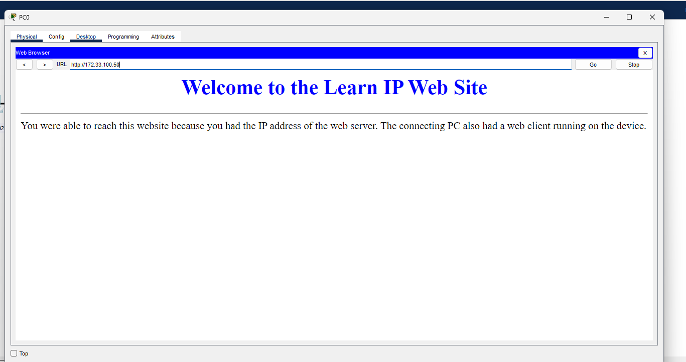

# Packet Tracer — Conectar-se a um servidor Web

`Cisco Packet Tracer` · `IPv4` · `ICMP` · `HTTP`

Laboratório baseado na atividade **Conectar-se a um servidor Web**, da Cisco Networking Academy.

**Data:** 21/10/2026 · **Resultado:** conectividade IP confirmada e página do servidor Web carregada no PC0.

## Objetivo

Testar a conectividade do PC0 com o endereço `172.33.100.50` e acessar o servidor pelo navegador do PC0.

## Cenário

| Elemento | Endereço / função |
| --- | --- |
| PC0 | Cliente com endereço IP 192.168.1.100 |
| Internet | Rede intermediária representada pela nuvem no simulador |
| Learn IP Web Server | Servidor Web com endereço IP 172.33.100.50 |



Os endereços e as conexões desta documentação pertencem ao ambiente simulado da atividade.

## 1. Teste inicial de conectividade

No Packet Tracer, abri **PC0 > Desktop > Command Prompt** e executei:

```text
ping 172.33.100.50
```

Resultado observado:

| Item | Resultado |
| --- | --- |
| Pacotes enviados | 4 |
| Pacotes recebidos | 3 |
| Pacotes perdidos | 1 (25%) |
| Primeira tentativa | Request timed out |
| Tentativas seguintes | Três respostas de 172.33.100.50 |
| Tempo mínimo / máximo / médio | 0 ms / 4 ms / 1 ms |



As respostas confirmam conectividade IP entre o PC0 e o destino durante o teste. O timeout inicial é compatível com a preparação da rede e a resolução ARP descritas no roteiro, mas sua causa não foi confirmada por captura de pacotes. O teste de ping, sozinho, não confirma que o serviço Web funciona.

## 2. Confirmação da conectividade

Executei novamente `ping 172.33.100.50` no PC0.

| Item | Resultado |
| --- | --- |
| Pacotes enviados | 4 |
| Pacotes recebidos | 4 |
| Pacotes perdidos | 0 (0%) |
| Tempo mínimo / máximo / médio | 0 ms / 14 ms / 3 ms |



A perda inicial não se repetiu neste segundo teste. Todas as solicitações receberam resposta, confirmando a conectividade IP naquele momento. A causa do timeout inicial permanece sem confirmação.

## 3. Acesso ao servidor Web

No PC0, fechei somente o Command Prompt e abri **Desktop > Web Browser**. No campo URL, digitei `http://172.33.100.50` e cliquei em **Go**.

A página carregou e exibiu o título:

> Welcome to the Learn IP Web Site

Também foi exibida a mensagem:

> You were able to reach this website because you had the IP address of the web server. The connecting PC also had a web client running on the device.



O carregamento da página confirma que o cliente Web do PC0 conseguiu acessar o serviço HTTP nesse endereço no ambiente simulado.

## Resposta à pergunta da atividade

**Quais mensagens você viu após a página Web ter sido carregada?**

Foi exibida a mensagem “Welcome to the Learn IP Web Site”. A página informou que o acesso foi possível porque eu tinha o endereço IP do servidor Web e o PC utilizado possuía um cliente Web em execução.

## O que pratiquei

- Testar a conectividade IP usando `ping` no Packet Tracer.
- Interpretar respostas, timeout e estatísticas de perda de pacotes.
- Repetir um teste para verificar se a perda persiste.
- Acessar um servidor HTTP pelo endereço IP no navegador.
- Diferenciar a confirmação de conectividade IP do teste de acesso ao serviço Web.
- Registrar os procedimentos e os resultados reais para documentar o laboratório.

## Validação

| Verificação | Resultado observado |
| --- | --- |
| Ping inicial para 172.33.100.50 | Três respostas e um timeout (25% de perda) |
| Repetição do ping | Quatro respostas, sem perda de pacotes |
| Acesso a http://172.33.100.50 | Página do servidor carregada no navegador do PC0 |
| Mensagens exibidas | Título de boas-vindas e explicação sobre o uso do IP e do cliente Web |

O ping confirmou a conectividade IP, e o navegador confirmou o acesso ao serviço Web. Como a URL usou diretamente o endereço IP, esse acesso não exigiu resolver um nome de domínio para localizar o servidor.

## Arquivos e evidências

- [conexao-servidor-web.pka](conexao-servidor-web.pka): arquivo da atividade obtido no curso, incluído para reprodução do cenário. Abra-o no Cisco Packet Tracer.
- [01-ping-inicial.png](imagens/01-ping-inicial.png): primeiro teste, com um timeout e três respostas.
- [02-ping-confirmacao.png](imagens/02-ping-confirmacao.png): segundo teste, sem perda de pacotes.
- [03-acesso-servidor-web.png](imagens/03-acesso-servidor-web.png): página carregada pelo endereço IP.
- [04-topologia-rede.png](imagens/04-topologia-rede.png): visão geral do cenário e dos endereços.

Os resultados da execução estão registrados nas capturas de tela e na documentação acima.

---

Documentação de estudo por **Jardel Luiz**. Cenário e atividade educacional: **Cisco Networking Academy**.
