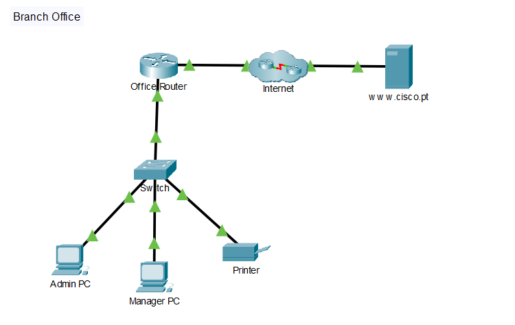
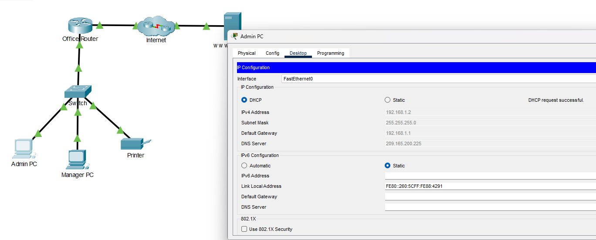
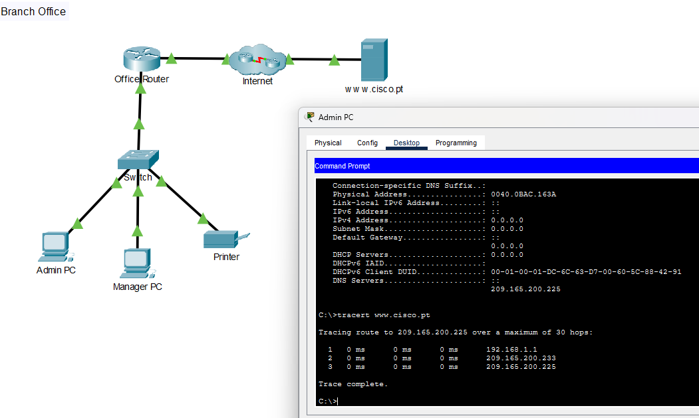

# Criar uma LAN no Cisco Packet Tracer

Montei a rede de uma filial com dois computadores e uma impressora. Configurei os PCs por DHCP e a impressora com IP fixo, testei a comunicação local e o acesso HTTP a um servidor remoto e analisei o caminho com `tracert`.

**Resultado:** os dois PCs alcançaram a impressora com 4 respostas e 0% de perda. Ambos acessaram a página do servidor por IP e por nome. Durante a montagem, corrigi uma ligação na interface errada do roteador que impedia o recebimento de endereços por DHCP.

[Voltar aos laboratórios](../README.md) · [Abrir arquivo da atividade](criar-uma-lan.pka) · [Respostas e reflexão](questoes-reflexao.md)

## Cenário e objetivo

Atividade educacional **Criar uma LAN**, da Cisco Networking Academy, realizada em **26/10/2026**. O Office Router e os demais dispositivos de rede já vieram configurados no cenário. Minha tarefa foi ligar os equipamentos, conectá-los nas portas previstas, configurar os dispositivos finais e validar os recursos locais e remotos.

A nuvem Internet e o servidor fazem parte da simulação do Packet Tracer; os testes não representam acesso à internet real.

## Conexões

Todos os cabos adicionados na atividade são **Copper Straight-Through**.

| Origem | Porta | Destino | Porta |
| --- | --- | --- | --- |
| Office Router | GigabitEthernet0/0 | ISP1, dentro da nuvem Internet | GigabitEthernet0/0 |
| Office Router | GigabitEthernet0/1 | Switch | GigabitEthernet0/1 |
| Admin PC | FastEthernet0 | Switch | FastEthernet0/1 |
| Manager PC | FastEthernet0 | Switch | FastEthernet0/2 |
| Printer | FastEthernet0 | Switch | FastEthernet0/24 |

A porta Fa0/24 foi definida pela tabela da atividade. Não é uma porta exclusiva para impressoras; o importante é seguir e documentar o projeto.

## Endereçamento observado

| Dispositivo | IPv4 | Máscara | Gateway | DNS | Método |
| --- | --- | --- | --- | --- | --- |
| Admin PC | 192.168.1.2 | 255.255.255.0 | 192.168.1.1 | 209.165.200.225 | DHCP |
| Manager PC | 192.168.1.3 | 255.255.255.0 | 192.168.1.1 | 209.165.200.225 | DHCP |
| Printer | 192.168.1.100 | 255.255.255.0 | Não necessário para o acesso local proposto | Não utilizado no teste | Estático |

A LAN é **192.168.1.0/24**. O Office Router fornece DHCP em **192.168.1.1**, confirmado pelo `ipconfig /all`. O servidor remoto de HTTP e DNS usa **209.165.200.225**.

## Falha encontrada e correção

O Admin PC exibiu **DHCP request failed**, mesmo com os links verdes. Ao conferir as portas, identifiquei que o Switch estava conectado à **G0/0 do Office Router**, enquanto o projeto reservava a **G0/1 para a LAN**.

Refiz as conexões: **G0/1 para o Switch** e **G0/0 para o ISP1**. Após os links ficarem verdes, solicitei DHCP novamente. O Admin recebeu **192.168.1.2**, máscara, gateway e DNS; o Manager recebeu **192.168.1.3**.

**Aprendizado:** um link verde confirma o enlace físico, mas não garante que o cabo esteja na interface correta para a configuração do serviço. Conferir o cabeamento e o projeto resolveu a falha sem alterar a configuração prévia do roteador. As capturas 03 e 04 registram o funcionamento após a correção; as telas da falha foram analisadas durante a prática.

## Testes e resultados

| Teste | Resultado observado | Evidência |
| --- | --- | --- |
| Admin → impressora: `ping 192.168.1.100` | 4 enviados, 4 recebidos, 0% de perda | [06](imagens/06-admin-ping-printer.png) |
| Manager → impressora: `ping 192.168.1.100` | 4 enviados, 4 recebidos, 0% de perda | [07](imagens/07-manager-ping-printer.png) |
| HTTP por IP no Manager | Página carregada em `http://209.165.200.225` | [08](imagens/08-manager-web-ip.png) |
| HTTP por nome no Manager | Página carregada; a captura registra `http://cisco.pt` | [09](imagens/09-manager-web-dns.png) |
| HTTP por IP no Admin | Página carregada em `http://209.165.200.225` | [10](imagens/10-admin-web-ip.png) |
| HTTP por nome no Admin | Página carregada em `http://www.cisco.pt` | [11](imagens/11-admin-web-dns.png) |
| `ipconfig` no Admin | IP, máscara e gateway da interface ativa | [12](imagens/12-admin-ipconfig.png) |
| `ipconfig /all` no Admin | MAC, DHCP e DNS, além do endereçamento | [13](imagens/13-admin-ipconfig-all.png) |
| `tracert www.cisco.pt` no Admin | Destino alcançado; dois roteadores intermediários | [14](imagens/14-admin-tracert.png) |

O ping verifica a comunicação IP com a impressora, não a impressão de um documento. O teste no navegador valida o serviço HTTP. Os dois nomes foram testados no Manager durante a prática; o print 09 preserva o endereço sem `www`.

### Caminho até o servidor

| Salto | Endereço | Identificação |
| --- | --- | --- |
| 1 | 192.168.1.1 | Office Router, gateway da LAN |
| 2 | 209.165.200.233 | Roteador do provedor na nuvem Internet |
| 3 | 209.165.200.225 | Servidor de destino |

São **dois roteadores** antes do servidor. A terceira linha é o destino, não um terceiro roteador.

## Evidências da prática

| Nº | Captura |
| --- | --- |
| 01 | [Topologia inicial](imagens/01-topologia-inicial.png) |
| 02 | [Topologia cabeada](imagens/02-topologia-cabeada.png) |
| 03 | [Admin PC — DHCP](imagens/03-admin-pc-dhcp.png) |
| 04 | [Manager PC — DHCP](imagens/04-manager-pc-dhcp.png) |
| 05 | [Impressora — IP fixo](imagens/05-printer-ip-fixo.png) |
| 06 | [Admin — ping na impressora](imagens/06-admin-ping-printer.png) |
| 07 | [Manager — ping na impressora](imagens/07-manager-ping-printer.png) |
| 08 | [Manager — HTTP por IP](imagens/08-manager-web-ip.png) |
| 09 | [Manager — HTTP por nome](imagens/09-manager-web-dns.png) |
| 10 | [Admin — HTTP por IP](imagens/10-admin-web-ip.png) |
| 11 | [Admin — HTTP por nome](imagens/11-admin-web-dns.png) |
| 12 | [Admin — ipconfig](imagens/12-admin-ipconfig.png) |
| 13 | [Admin — ipconfig /all](imagens/13-admin-ipconfig-all.png) |
| 14 | [Admin — tracert](imagens/14-admin-tracert.png) |

## Como consultar

1. Baixe [criar-uma-lan.pka](criar-uma-lan.pka) e abra no Cisco Packet Tracer.
2. Consulte a tabela de conexões e as configurações dos dispositivos finais.
3. Repita os pings para a impressora e os acessos HTTP nos dois PCs.
4. No Admin, compare `ipconfig` e `ipconfig /all` e execute `tracert www.cisco.pt`.

O arquivo PKA foi incluído a partir da pasta fornecida ao final da prática. Esta documentação registra os resultados das capturas; não atribui uma nota de avaliação automática, pois não foi apresentada uma tela de Check Results.

## Relação com Suporte N1

Pratiquei conferência de portas e cabos, diagnóstico de falha de DHCP, leitura de IP/máscara/gateway/DNS e testes que diferenciam conectividade IP, resolução de nomes e acesso a uma aplicação. A sequência de verificar, corrigir e testar novamente também ajuda a registrar um atendimento com evidências.

---

Prática e registros: **Jardel Luiz**. Cenário e atividade: **Cisco Networking Academy**.
