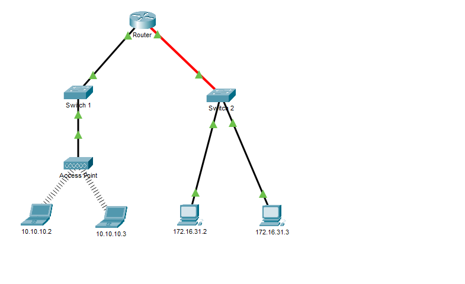
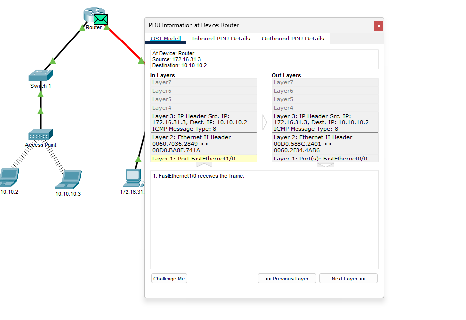
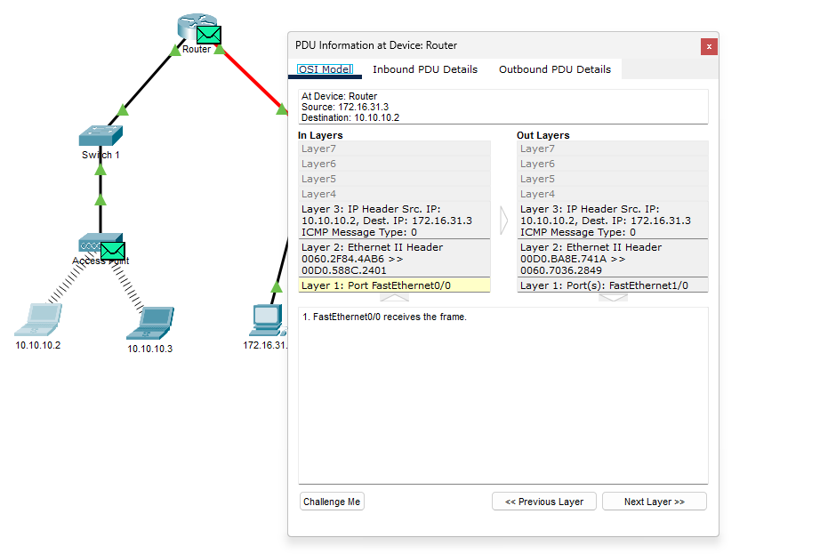
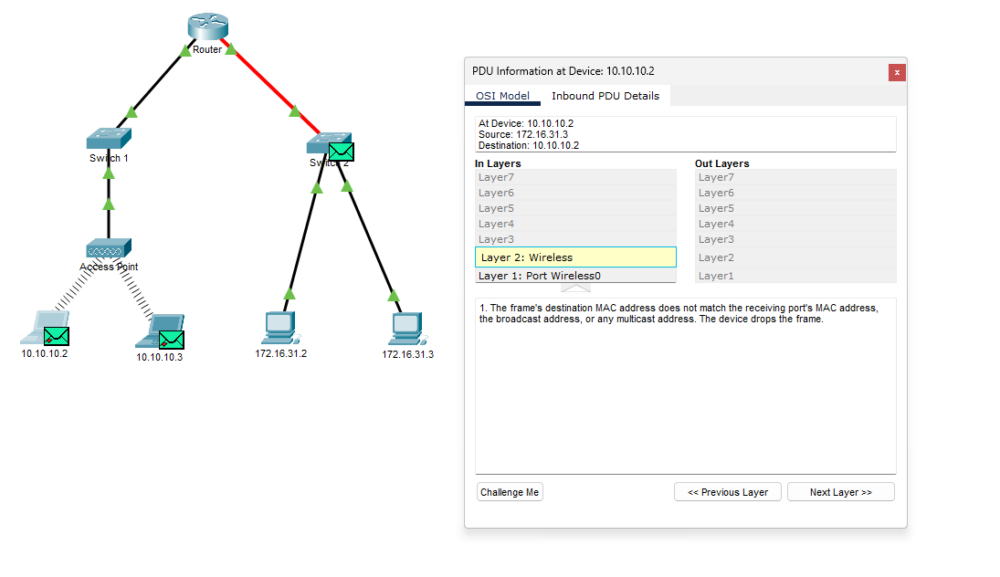
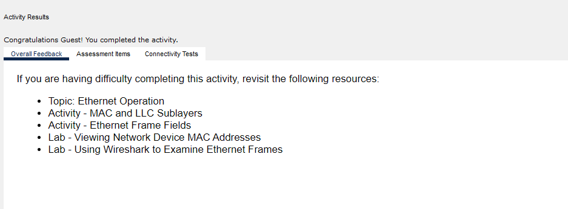

# Identificação de endereços MAC e IP

Prática da **Cisco Networking Academy** no **Cisco Packet Tracer**, documentada por **Jardel Luiz**. Examinei uma comunicação local e outra entre redes, acompanhando quadros Ethernet, quadros Wi-Fi e pacotes IPv4.

**Resultado observado:** os switches preservaram os MACs, o roteador trocou os MACs ao encaminhar entre redes e os IPs permaneceram iguais em cada sentido. O access point adaptou Ethernet e 802.11. A resposta ao ping chegou ao PC de origem, e o simulador informou conclusão da atividade.

[Abrir atividade salva](identificar-enderecos-mac-ip.pka) · [Planilha das PDUs](tabelas-mac-ip.xlsx) · [15 respostas comentadas](questoes-reflexao.md) · [Capturas](imagens/)

## Topologia e conceitos



- Rede dos PCs: **172.16.31.0/24**, conectada ao Switch 2.
- Rede dos notebooks: **10.10.10.0/24**, conectada pelo AP e Switch 1.
- O roteador conecta as duas redes. Não foi necessário configurar os dispositivos nesta atividade.
- **IP** identifica origem e destino do pacote. **MAC** participa da entrega no enlace. **ICMP** transporta os pedidos e respostas do ping.

Uma mensagem ICMP fica dentro de um pacote IP, encapsulado em um quadro Ethernet ou Wi-Fi. Cada camada tem seu papel: um enlace ativo não é, sozinho, prova de conectividade IP ou de funcionamento de uma aplicação.

## 1. Comunicação dentro da mesma rede

No host **172.16.31.3**, abri Desktop → Command Prompt e executei:

```text
ping 172.16.31.2
```

O primeiro teste teve **4 enviados, 4 recebidos e 0% de perda** ([02](imagens/02-ping-rede-local.png)). Em seguida, mudei para Simulation, repeti o comando, abri a PDU na origem e avancei com Capture/Forward. Inspecionei o Switch 2 e o PC de destino.

O destino estava na mesma rede: o PC usou diretamente o MAC do outro PC. O quadro passou pelo switch sem precisar atravessar o roteador. No destino, o ICMP tipo 8 (Echo Request) gerou uma resposta tipo 0 (Echo Reply), invertendo origem e destino.

### Tabela da comunicação local

| Dispositivo / etapa | MAC de origem | MAC de destino | IPv4 de origem | IPv4 de destino | Mensagem | Evidências | Observação |
| --- | --- | --- | --- | --- | --- | --- | --- |
| PC 172.16.31.3 — saída | 0060.7036.2849 | 000C.85CC.1DA7 | 172.16.31.3 | 172.16.31.2 | Pedido | [03](imagens/03-pdu-local-origem-modelo-osi.png), [04](imagens/04-pdu-local-origem-cabecalhos.png) | Echo Request; ICMP tipo 8. |
| Switch 2 — entrada/saída | 0060.7036.2849 | 000C.85CC.1DA7 | 172.16.31.3 | 172.16.31.2 | Pedido | [05](imagens/05-pdu-local-switch2.png) | MACs observados; IPs preservados no pacote. Layer 3 não exibida. |
| PC 172.16.31.2 — entrada | 0060.7036.2849 | 000C.85CC.1DA7 | 172.16.31.3 | 172.16.31.2 | Pedido | [06](imagens/06-pdu-local-destino-pedido-resposta.png) | Pedido recebido. |
| PC 172.16.31.2 — saída | 000C.85CC.1DA7 | 0060.7036.2849 | 172.16.31.2 | 172.16.31.3 | Resposta | [06](imagens/06-pdu-local-destino-pedido-resposta.png), [07](imagens/07-pdu-local-resposta-cabecalhos.png) | Echo Reply; ICMP tipo 0. |

Os IPs nas linhas dos switches representam o pacote transportado, preservado entre os pontos observados. A aba OSI Model dos switches não exibe processamento de Layer 3; isso não significa ausência de IP no pacote. Esta convenção vale também para as tabelas seguintes. As quatro linhas locais correspondem à coleta solicitada: origem, switch, entrada no destino e resposta criada no destino. O caminho de volta local não foi capturado ponto a ponto.

## 2. Ping para outra rede e interfaces do roteador

Em Realtime, executei no mesmo PC:

```text
ping 10.10.10.2
```

O primeiro teste remoto teve **4 enviados, 3 recebidos, 1 perdido (25%)**. A repetição teve **4 enviados, 4 recebidos e 0% de perda** ([08](imagens/08-ping-rede-remota.png), [09](imagens/09-ping-rede-remota-repeticao.png)). A perda inicial não se repetiu. Não foi capturado um evento ARP que comprovasse sua causa, portanto não atribuo a perda a ARP como fato confirmado. Os tempos medidos são do simulador, não da Internet real.

Passei o mouse sobre o Router para conferir suas interfaces ([10](imagens/10-interfaces-roteador.png)):

| Interface ativa | IP | MAC |
| --- | --- | --- |
| FastEthernet1/0 | 172.16.31.1/24 | 00D0.BA8E.741A |
| FastEthernet0/0 | 10.10.10.1/24 | 00D0.588C.2401 |

Para alcançar outra rede, o PC usa o **MAC do gateway** no quadro, mantendo o **IP do notebook** como destino final. O MAC do roteador não substitui o IP do destino.

## 3. Ida até o notebook remoto

Em Simulation, repeti o ping remoto. Acompanhei a sequência **PC → Switch 2 → Router → Switch 1 → AP → notebook**, abrindo as PDUs a cada etapa.

| Dispositivo / etapa | MAC de origem | MAC de destino | IPv4 de origem | IPv4 de destino | Mensagem | Evidências | Observação |
| --- | --- | --- | --- | --- | --- | --- | --- |
| PC 172.16.31.3 — saída | 0060.7036.2849 | 00D0.BA8E.741A | 172.16.31.3 | 10.10.10.2 | Pedido | [11](imagens/11-pdu-remota-origem.png) | Destino MAC é o gateway; destino IP é o notebook. |
| Switch 2 — entrada/saída | 0060.7036.2849 | 00D0.BA8E.741A | 172.16.31.3 | 10.10.10.2 | Pedido | [12](imagens/12-pdu-remota-switch2.png) | MACs preservados; Layer 3 não exibida. |
| Router — entrada Fa1/0 | 0060.7036.2849 | 00D0.BA8E.741A | 172.16.31.3 | 10.10.10.2 | Pedido | [13](imagens/13-pdu-remota-roteador-entrada-saida.png) | Recebe o quadro da rede 172.16.31.0/24. |
| Router — saída Fa0/0 | 00D0.588C.2401 | 0060.2F84.4AB6 | 172.16.31.3 | 10.10.10.2 | Pedido | [13](imagens/13-pdu-remota-roteador-entrada-saida.png) | Novo quadro Ethernet; IPs preservados. |
| Switch 1 — entrada/saída | 00D0.588C.2401 | 0060.2F84.4AB6 | 172.16.31.3 | 10.10.10.2 | Pedido | [14](imagens/14-pdu-remota-switch1.png) | MACs preservados; Layer 3 não exibida. |
| AP — saída Wi-Fi | 00D0.588C.2401 | 0060.2F84.4AB6 | 172.16.31.3 | 10.10.10.2 | Pedido | [15](imagens/15-pdu-remota-access-point.png), [16](imagens/16-pdu-remota-access-point-saida-wifi.png) | MACs lógicos. Transmissor de rádio é o AP; ver aba Wi-Fi. |
| Notebook — entrada | 00D0.588C.2401 | 0060.2F84.4AB6 | 172.16.31.3 | 10.10.10.2 | Pedido | [16](imagens/16-pdu-remota-access-point-saida-wifi.png), [17](imagens/17-pdu-remota-destino-pedido-resposta.png) | IPs e tipo 8 observados. MACs do quadro Wi-Fi enviado pelo AP. |



No roteador, o quadro com origem 0060.7036.2849 e destino 00D0.BA8E.741A foi substituído por outro com origem 00D0.588C.2401 e destino 0060.2F84.4AB6. Os IPs continuaram **172.16.31.3 → 10.10.10.2**. Esse é encaminhamento entre redes sem tradução dos IPs observados, diferente do laboratório anterior de NAT.

## 4. Encapsulamento no access point

A aba OSI Model do AP mostrou apenas a Layer 1 ([15](imagens/15-pdu-remota-access-point.png)), mas Outbound PDU Details revelou **802.11 Wireless** ([16](imagens/16-pdu-remota-access-point-saida-wifi.png)). O cabeçalho Wi-Fi distingue o transmissor/receptor pelo rádio dos endereços lógicos do quadro no lado cabeado.

| Transmissão | Address 1 | Address 2 | Address 3 | Evidência |
| --- | --- | --- | --- | --- |
| AP para notebook | 0060.2F84.4AB6 — receptor/destino | 0050.0FAB.6C82 — transmissor/AP | 00D0.588C.2401 — origem cabeada | [16](imagens/16-pdu-remota-access-point-saida-wifi.png) |
| Notebook para AP | 0050.0FAB.6C82 — receptor/AP | 0060.2F84.4AB6 — transmissor/origem | 00D0.588C.2401 — destino cabeado | [18](imagens/18-pdu-remota-resposta-origem-wifi.png) |

Por isso as tabelas de percurso usam **MAC de origem/destino lógicos** nas linhas Wi-Fi, e esta tabela registra os três campos reais. Na ida, Address 3 representa a origem cabeada; na volta, representa o destino cabeado. O papel dos campos depende da direção da transmissão.

No retorno, a saída do AP voltou a mostrar Ethernet II, com origem no notebook e destino no roteador ([19](imagens/19-pdu-remota-retorno-access-point-ethernet.png)). O AP preservou os IPs, e o TTL permaneceu 128 entre a saída do notebook e a saída Ethernet do AP. Sua função de ponte envolve camada 2, ainda que a visualização OSI desta atividade seja simplificada.

## 5. Resposta e retorno ao PC

O notebook recebeu o pedido e criou o Echo Reply: agora o IP de origem era **10.10.10.2** e o destino **172.16.31.3** ([17](imagens/17-pdu-remota-destino-pedido-resposta.png)). Acompanhei **notebook → AP → Switch 1 → Router → Switch 2 → PC**.

| Dispositivo / etapa | MAC de origem | MAC de destino | IPv4 de origem | IPv4 de destino | Mensagem | Evidências | Observação |
| --- | --- | --- | --- | --- | --- | --- | --- |
| Notebook — saída Wi-Fi | 0060.2F84.4AB6 | 00D0.588C.2401 | 10.10.10.2 | 172.16.31.3 | Resposta | [17](imagens/17-pdu-remota-destino-pedido-resposta.png), [18](imagens/18-pdu-remota-resposta-origem-wifi.png) | MACs lógicos; receptor de rádio é o AP. |
| AP — saída Ethernet | 0060.2F84.4AB6 | 00D0.588C.2401 | 10.10.10.2 | 172.16.31.3 | Resposta | [19](imagens/19-pdu-remota-retorno-access-point-ethernet.png) | Converte o encapsulamento para Ethernet II. |
| Switch 1 — entrada/saída | 0060.2F84.4AB6 | 00D0.588C.2401 | 10.10.10.2 | 172.16.31.3 | Resposta | [20](imagens/20-pdu-remota-retorno-switch1.png) | MACs preservados; Layer 3 não exibida. |
| Router — entrada Fa0/0 | 0060.2F84.4AB6 | 00D0.588C.2401 | 10.10.10.2 | 172.16.31.3 | Resposta | [21](imagens/21-pdu-remota-retorno-roteador.png) | Resposta recebida da rede 10.10.10.0/24. |
| Router — saída Fa1/0 | 00D0.BA8E.741A | 0060.7036.2849 | 10.10.10.2 | 172.16.31.3 | Resposta | [21](imagens/21-pdu-remota-retorno-roteador.png) | Novo quadro para a rede do PC; IPs preservados. |
| Switch 2 — entrada/saída | 00D0.BA8E.741A | 0060.7036.2849 | 10.10.10.2 | 172.16.31.3 | Resposta | [22](imagens/22-pdu-remota-retorno-switch2.png) | MACs preservados; Layer 3 não exibida. |
| PC 172.16.31.3 — entrada | 00D0.BA8E.741A | 0060.7036.2849 | 10.10.10.2 | 172.16.31.3 | Resposta | [25](imagens/25-resposta-remota-recebida-no-pc.png) | Echo Reply recebido; ICMP tipo 0. |



O roteador mudou os MACs de acordo com a interface de saída e preservou os IPs. Na chegada ao PC, o pacote trazia IP de origem do notebook e MAC de origem da interface do roteador ([25](imagens/25-resposta-remota-recebida-no-pc.png)). Isso é esperado: origem IP e origem Ethernet têm funções diferentes.

## 6. Investigação dos X vermelhos

Durante o retorno, apareceram X vermelhos nos dois notebooks. Abri cada evento e selecionei **Layer 2: Wireless**. O texto informou descarte porque o MAC de destino não correspondia à interface receptora nem a broadcast/multicast aceito ([23](imagens/23-descarte-wifi-mac-destino-diferente.png), [24](imagens/24-descarte-wifi-notebook-10-10-10-3.png)).



Esses dois eventos comprovam filtragem por endereço MAC. O descarte observado não equivale a falha do ping inteiro: a resposta foi acompanhada até o PC e a repetição em Realtime teve 0% de perda. Não generalizo esse motivo para todo X vermelho do Packet Tracer. Também não atribuo a origem exata dessas cópias a um mecanismo não capturado.

O resumo Source/Destination no topo de algumas janelas continuou mostrando o pedido inicial, mesmo no retorno. Para determinar a direção atual, usei os campos dos cabeçalhos de entrada/saída.

## 7. Verificação final e respostas



A tela Activity Results exibiu **“Congratulations Guest! You completed the activity.”** O texto abaixo apresenta recursos de revisão; não é uma reprovação. Não há percentual numérico documentado nessa captura.

As **[15 questões de reflexão](questoes-reflexao.md)** incluem a resposta esperada pelo material e a explicação técnica quando a simplificação exige cuidado. O enunciado contém exemplos inconsistentes, como troca entre 172.16.31.3 e 172.16.31.5 e alguns MACs. As tabelas deste documento seguem as capturas desta execução.

## Evidências

- **01** — [01-topologia-inicial.png](imagens/01-topologia-inicial.png)
- **02** — [02-ping-rede-local.png](imagens/02-ping-rede-local.png)
- **03** — [03-pdu-local-origem-modelo-osi.png](imagens/03-pdu-local-origem-modelo-osi.png)
- **04** — [04-pdu-local-origem-cabecalhos.png](imagens/04-pdu-local-origem-cabecalhos.png)
- **05** — [05-pdu-local-switch2.png](imagens/05-pdu-local-switch2.png)
- **06** — [06-pdu-local-destino-pedido-resposta.png](imagens/06-pdu-local-destino-pedido-resposta.png)
- **07** — [07-pdu-local-resposta-cabecalhos.png](imagens/07-pdu-local-resposta-cabecalhos.png)
- **08** — [08-ping-rede-remota.png](imagens/08-ping-rede-remota.png)
- **09** — [09-ping-rede-remota-repeticao.png](imagens/09-ping-rede-remota-repeticao.png)
- **10** — [10-interfaces-roteador.png](imagens/10-interfaces-roteador.png)
- **11** — [11-pdu-remota-origem.png](imagens/11-pdu-remota-origem.png)
- **12** — [12-pdu-remota-switch2.png](imagens/12-pdu-remota-switch2.png)
- **13** — [13-pdu-remota-roteador-entrada-saida.png](imagens/13-pdu-remota-roteador-entrada-saida.png)
- **14** — [14-pdu-remota-switch1.png](imagens/14-pdu-remota-switch1.png)
- **15** — [15-pdu-remota-access-point.png](imagens/15-pdu-remota-access-point.png)
- **16** — [16-pdu-remota-access-point-saida-wifi.png](imagens/16-pdu-remota-access-point-saida-wifi.png)
- **17** — [17-pdu-remota-destino-pedido-resposta.png](imagens/17-pdu-remota-destino-pedido-resposta.png)
- **18** — [18-pdu-remota-resposta-origem-wifi.png](imagens/18-pdu-remota-resposta-origem-wifi.png)
- **19** — [19-pdu-remota-retorno-access-point-ethernet.png](imagens/19-pdu-remota-retorno-access-point-ethernet.png)
- **20** — [20-pdu-remota-retorno-switch1.png](imagens/20-pdu-remota-retorno-switch1.png)
- **21** — [21-pdu-remota-retorno-roteador.png](imagens/21-pdu-remota-retorno-roteador.png)
- **22** — [22-pdu-remota-retorno-switch2.png](imagens/22-pdu-remota-retorno-switch2.png)
- **23** — [23-descarte-wifi-mac-destino-diferente.png](imagens/23-descarte-wifi-mac-destino-diferente.png)
- **24** — [24-descarte-wifi-notebook-10-10-10-3.png](imagens/24-descarte-wifi-notebook-10-10-10-3.png)
- **25** — [25-resposta-remota-recebida-no-pc.png](imagens/25-resposta-remota-recebida-no-pc.png)
- **26** — [26-verificacao-atividade.png](imagens/26-verificacao-atividade.png)

## Como abrir e repetir

1. Baixe o [arquivo .pka](identificar-enderecos-mac-ip.pka) e abra no Packet Tracer.
2. Execute o ping local em Realtime e depois em Simulation. Inspecione origem, switch e destino.
3. Execute o ping remoto, registre o resultado e repita se houver perda inicial.
4. Em Simulation, acompanhe o pedido e o retorno. Use os endereços e o tipo ICMP para identificar a PDU; números de sequência e instantes podem variar entre testes.
5. Compare com as [tabelas em Excel](tabelas-mac-ip.xlsx) e consulte as respostas comentadas.

O pacote inclui os arquivos fornecidos pelo autor e as capturas. O .pka foi conferido como cópia idêntica ao arquivo entregue; não foi reexecutado automaticamente durante a organização da documentação.

## Aplicação em suporte

O exercício ajuda a diferenciar comunicação local de comunicação entre redes, reconhecer quando o gateway participa e interpretar capturas por camada. Também reforça que uma primeira perda no ping ou um X vermelho precisam de contexto antes de se concluir que existe uma falha geral.

---

Prática por **Jardel Luiz**. Atividade educacional **“Identificação de Endereços MAC e IP” — Cisco Networking Academy**. Ambiente de estudo e simulação.
