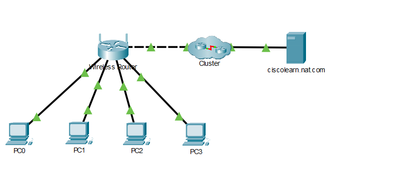
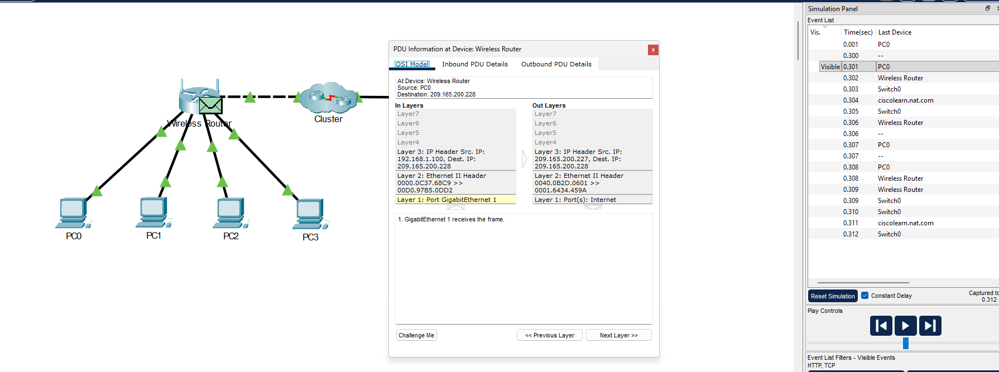
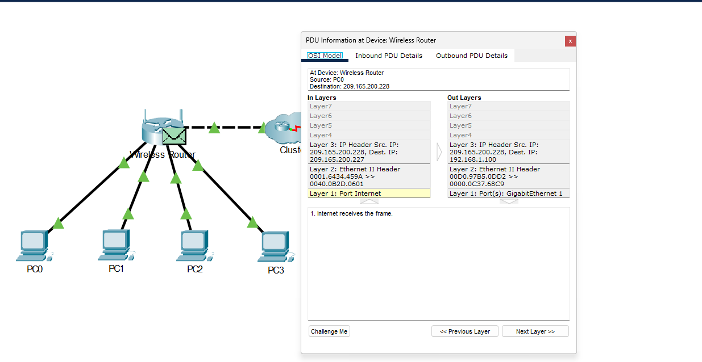

# NAT em um roteador sem fio

Laboratório da **Cisco Networking Academy**, realizado no **Cisco Packet Tracer**. Conectei quatro PCs por cabo, obtive suas configurações por DHCP e acompanhei uma comunicação TCP destinada ao serviço HTTP de um servidor externo.

**Resultado:** observei o IP privado do PC0 ser traduzido para o IP externo do roteador na ida e a tradução inversa do destino no retorno. O **Check Results** exibiu a mensagem de atividade concluída.

[Voltar ao índice](../README.md) · [Baixar a atividade salva](examinando-nat-roteador-sem-fio.pka) · [Todas as evidências](imagens/)

## 1. Cenário e objetivo

O objetivo foi entender como um computador com endereço privado se comunica com um servidor na rede externa usando NAT. Embora o equipamento seja um roteador sem fio, os quatro PCs desta atividade foram conectados por **cabos de cobre diretos** às portas LAN.



O **Cluster** agrupa dispositivos da rede externa para simplificar a topologia. A lista de eventos revelou um **Switch0** dentro desse agrupamento. O servidor é identificado como **ciscolearn.nat.com**.

## 2. Endereçamento observado

| Dispositivo ou função | IPv4 | Máscara / observação |
| --- | --- | --- |
| PC0 | `192.168.1.100` | `255.255.255.0` |
| PC1 | `192.168.1.101` | `255.255.255.0` |
| PC2 | `192.168.1.102` | `255.255.255.0` |
| PC3 | `192.168.1.103` | `255.255.255.0` |
| Roteador — LAN | `192.168.1.1` | Gateway e servidor DHCP dos PCs |
| Roteador — WAN | `209.165.200.227` | `255.255.255.224`; recebido por DHCP |
| Gateway externo do roteador | `209.165.200.225` | Próximo salto na rede externa |
| DNS configurado nos PCs | `209.165.200.226` | Servidor indicado para resolução de nomes |
| Servidor web | `209.165.200.228` | Destino selecionado para a PDU HTTP |

A LAN é `192.168.1.0/24`. O DHCP distribui de `192.168.1.100` a `192.168.1.149`: **50 endereços**, que são apenas uma parte da rede. O roteador usa `.1`, fora da faixa de distribuição, mas dentro da mesma rede.

**Respostas do enunciado:** o endereço da porta Internet é público no cenário simulado; os endereços da rede interna são privados. Os endereços externos deste documento pertencem ao laboratório e não representam uma comprovação de acesso à Internet real.

## 3. Primeiro PC, cabo e DHCP

1. Adicionei o PC0 e conectei sua interface **FastEthernet0** a uma porta LAN do roteador usando **Copper Straight-Through**.
2. Aguardei os indicadores ficarem verdes. Um indicador inicialmente laranja mudou para verde após a espera; não foi necessário alterar o cabeamento.
3. Em **Desktop → IP Configuration**, selecionei **DHCP**. A mensagem **DHCP request successful** confirmou o recebimento da configuração.
4. Anotei IP, máscara, gateway e DNS.

**Por que fazer isso:** o cabo estabelece o enlace; o DHCP fornece automaticamente os parâmetros de rede. Indicadores verdes, sozinhos, não comprovam acesso a uma aplicação externa.

Evidências: [cenário inicial](imagens/01-topologia-inicial.png), [PC0 conectado](imagens/02-pc0-conectado-lan.png) e [configuração DHCP](imagens/03-pc0-configuracao-dhcp.png).

## 4. Administração do roteador: LAN e WAN

No navegador do PC0, acessei `http://192.168.1.1` e utilizei as credenciais de laboratório fornecidas no enunciado (`admin` / `admin`).

- **Setup:** conferi o IP interno, DHCP habilitado, endereço inicial `.100` e limite de 50 endereços.
- **Status → Router:** observei o endereço WAN `209.165.200.227`, o gateway externo e a configuração automática por DHCP.
- **Status → Local Network:** conferi a LAN e a faixa DHCP de `.100` até `.149`.

O roteador exerce dois papéis: **cliente DHCP** na WAN, recebendo uma configuração do provedor simulado, e **servidor DHCP** na LAN, entregando configurações aos PCs. Gateway e DHCP podem ter o mesmo IP, mas são funções diferentes.

Evidências: [administração e DHCP](imagens/04-acesso-roteador-configuracao-lan-dhcp.png), [WAN](imagens/05-roteador-ip-externo-wan.png) e [rede local](imagens/06-rede-local-faixa-dhcp.png).

## 5. Quatro PCs e conferência com ipconfig

Adicionei PC1, PC2 e PC3 às portas LAN livres, aguardei os enlaces verdes e selecionei DHCP em cada novo PC. Em **Desktop → Command Prompt**, executei em todos:

```text
ipconfig /all
```

O comando mostra a configuração das interfaces; não altera os parâmetros e não testa a comunicação. Analisei a seção **FastEthernet0**, correspondente à conexão por cabo. A seção Bluetooth não era a interface utilizada neste cenário.

Os quatro PCs apresentaram IPs diferentes (`.100` a `.103`), com a mesma máscara, gateway, DHCP e DNS. Isso confirmou a coerência da configuração observada. Não presumi os endereços pela ordem de criação: conferi cada saída.

Evidências: [PC1](imagens/08-pc1-ipconfig-all.png), [PC2](imagens/09-pc2-ipconfig-all.png), [PC3](imagens/10-pc3-ipconfig-all.png) e [PC0](imagens/11-pc0-ipconfig-all.png).

## 6. Preparação da simulação HTTP/TCP

Em **Simulation**, desmarquei os eventos e habilitei apenas **TCP** e **HTTP** em **Edit Filters → Misc**. Esses filtros controlam a visualização; não bloqueiam os demais protocolos.

Usei **Add Complex PDU**, selecionei o PC0 como origem, mudei a aplicação para HTTP e cliquei no servidor para preencher o destino.

| Parâmetro | Valor utilizado | Significado |
| --- | --- | --- |
| Origem | PC0 | Computador que inicia a comunicação |
| Aplicação | HTTP | Serviço web escolhido para o teste |
| Destino | `209.165.200.228` | Servidor externo |
| Starting Source Port | `1000` | Porta de origem solicitada pelo enunciado |
| Destination Port | `80` | Porta do serviço HTTP |
| Periodic / Interval | `120` segundos | Repetição no tempo da simulação |

Mantive os demais campos como estavam, incluindo o campo Source IP Address em branco. O pacote capturado confirmou que a origem utilizada foi o IP do PC0. As portas TCP são identificadores lógicos da comunicação, não os conectores físicos do cabo.

Durante o preenchimento, apareceu **Invalid Destination IP Address Entered** com o destino vazio. Selecionei o servidor na topologia, que preencheu `209.165.200.228`, e completei a configuração. Esse aviso era de configuração da PDU; não demonstrava falha na rede.

Após **Create PDU**, o teste apareceu na lista inferior. Iniciei a reprodução para gerar eventos e pausei para examinar os pacotes. **Last Device** indica o dispositivo anterior do evento. O teste HTTP utiliza TCP; o estabelecimento da conexão ocorre antes da requisição HTTP.

Evidências: [filtros](imagens/12-filtros-simulacao-tcp-http.png), [PDU configurada](imagens/13-configuracao-pdu-http.png) e [tráfego registrado](imagens/14-trafego-na-simulacao.png).

## 7. NAT na ida: tradução da origem

Selecionei o evento de `0.301 s`, com PC0 em **Last Device**, e abri os detalhes da PDU no **Wireless Router**. Comparei **Inbound PDU Details** com **Outbound PDU Details**.

| Campo | Entrada pela LAN | Saída pela WAN |
| --- | --- | --- |
| **IP de origem** | **`192.168.1.100`** | **`209.165.200.227`** |
| IP de destino | `209.165.200.228` | `209.165.200.228` |
| Porta TCP de origem | `1000` | `1000` |
| Porta TCP de destino | `80` | `80` |
| TTL | `128` | `127` |



O roteador substituiu o IP privado de origem pelo seu IP externo. O servidor permaneceu como destino. A flag TCP **SYN** estava ativa: esse pacote inicia a conexão TCP, ainda não é a requisição HTTP em si.

A redução do TTL é consequência do encaminhamento pelo roteador, não a tradução NAT. As portas foram preservadas neste fluxo; a captura não mostra uma alteração de número de porta.

Cabeçalhos: [entrada antes da tradução](imagens/19-nat-ida-pacote-entrada.png) e [saída após a tradução](imagens/20-nat-ida-pacote-saida.png).

## 8. NAT no retorno: tradução do destino

Também examinei um pacote vindo do servidor e passando pelo roteador em direção ao PC0.

| Campo | Entrada pela WAN | Saída pela LAN |
| --- | --- | --- |
| IP de origem | `209.165.200.228` | `209.165.200.228` |
| **IP de destino** | **`209.165.200.227`** | **`192.168.1.100`** |
| Porta TCP de origem | `80` | `80` |
| Porta TCP de destino | `1000` | `1000` |
| TTL | `128` | `127` |



O pacote chegou destinado ao endereço externo do roteador. O roteador traduziu o destino para o endereço privado do PC0, mantendo o servidor como origem. Esse comportamento é consistente com o uso do estado da tradução da comunicação; a tabela interna de NAT não foi aberta nesta atividade.

Cabeçalhos: [entrada do retorno](imagens/16-nat-retorno-pacote-entrada.png) e [saída para o PC0](imagens/17-nat-retorno-pacote-saida.png).

## 9. Validação e limites das evidências

O **Check Results → Overall Feedback** exibiu **“Congratulations! You completed the activity.”**


- Os quatro PCs foram conectados e tiveram suas configurações conferidas.
- LAN, WAN e faixa DHCP foram identificadas.
- A simulação foi configurada para HTTP/TCP.
- A tradução NAT foi observada nos cabeçalhos, na ida e no retorno.
- A atividade recebeu a confirmação de conclusão do simulador.

Os prints comprovam a tradução nos pacotes TCP da comunicação configurada para HTTP. Não foi registrada uma página do servidor externo carregada no navegador nem um teste separado de resolução DNS. O acesso ao painel web do roteador foi registrado. Não atribuo um percentual numérico à avaliação, pois a evidência mostra a mensagem de conclusão.

## 10. O que aprendi e relação com suporte

Aprendi a separar **enlace ativo**, **configuração IP**, **roteamento** e **funcionamento de uma aplicação**. Também distingui DHCP (fornecimento de parâmetros), DNS (resolução de nomes) e NAT (tradução de endereços).

Em suporte, essa separação ajuda a investigar por que um computador tem conexão por cabo, mas não consegue acessar determinado serviço. O método é conferir a interface usada, IP/máscara, gateway e DNS, e então testar o caminho e a aplicação. Neste laboratório, acompanhar o mesmo pacote antes e depois do roteador tornou a tradução visível.

## Como abrir e repetir

1. Baixe [examinando-nat-roteador-sem-fio.pka](examinando-nat-roteador-sem-fio.pka) e abra no Cisco Packet Tracer.
2. Consulte a topologia e as configurações dos PCs e do roteador.
3. Em Simulation, habilite TCP e HTTP. Se a PDU periódica já estiver presente, reutilize-a; caso contrário, recrie-a com os parâmetros da seção 6.
4. Execute a simulação, pause e abra um evento no roteador. Os tempos podem mudar em uma nova execução: identifique a direção pelos endereços dos cabeçalhos.
5. Compare entrada e saída e consulte Check Results. Caso os eventos antigos não estejam disponíveis após reabrir, gere uma nova captura.

As 21 imagens estão em [imagens/](imagens/), numeradas na ordem em que foram registradas. Nesta execução, examinei primeiro o retorno e depois a ida.

---

Prática e documentação por **Jardel Luiz**. Atividade educacional **“Examinando o NAT em um roteador sem fio” — Cisco Networking Academy**. Ambiente de estudo e simulação.
