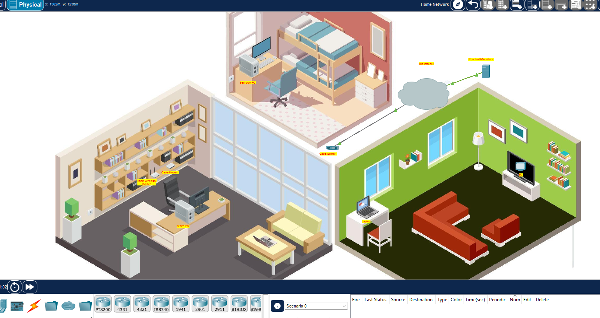
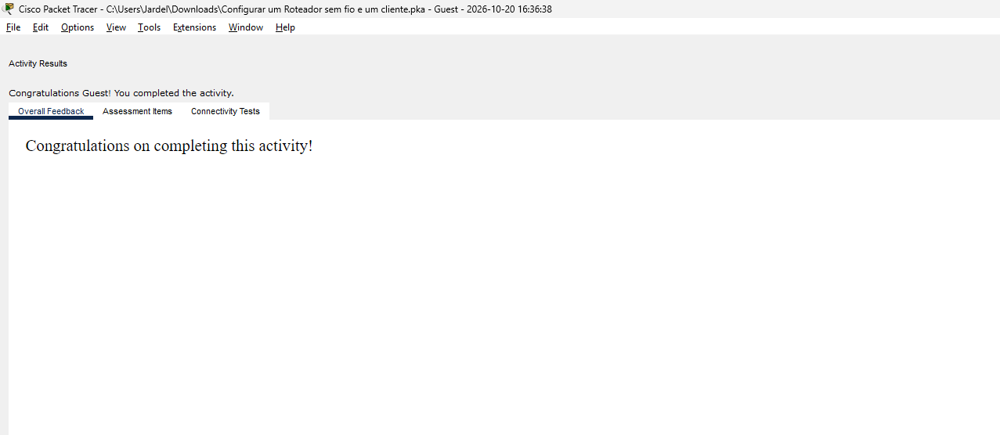

# Rede doméstica com roteador sem fio

`Cisco Packet Tracer` · `DHCP` · `Wi-Fi` · `WPA2 Personal`

Configuração de uma rede doméstica com dois computadores conectados por cabo e um notebook conectado por Wi-Fi. Laboratório baseado na atividade **4.4.4 — Configurar um roteador sem fio e clientes**, da Cisco Networking Academy.

**Data:** 20/10/2026 · **Resultado:** atividade concluída, conforme a avaliação do simulador.

## Objetivo

Conectar os dispositivos da residência, configurar o roteador para distribuir endereços IP, proteger a rede sem fio e testar o acesso ao servidor web da atividade.

## Cenário inicial

O ambiente contém um divisor coaxial, uma TV, um cable modem, um roteador sem fio, dois PCs e um notebook. A infraestrutura do provedor e o servidor já fazem parte do cenário fornecido pelo curso.

## Conexões realizadas

| Origem | Destino | Cabo |
| --- | --- | --- |
| Cable Splitter — Coaxial1 | Cable Modem — Port 0 | Coaxial |
| Cable Splitter — Coaxial2 | TV — Port 0 | Coaxial |
| Cable Modem — Port 1 | Home Wireless Router — Internet | Copper Straight-Through |
| Office PC — FastEthernet0 | Home Wireless Router — GigabitEthernet 1 | Copper Straight-Through |
| Bedroom PC — FastEthernet0 | Home Wireless Router — GigabitEthernet 2 | Copper Straight-Through |
| Laptop | Rede MyHome | Wi-Fi em 2,4 GHz |

A TV foi ligada após a conexão coaxial e apresentou imagem, confirmando o funcionamento dessa parte da atividade.

## Configurações do roteador

| Parâmetro | Configuração |
| --- | --- |
| IP da interface LAN / gateway dos clientes | 192.168.0.1 |
| Máscara da LAN | 255.255.255.0 |
| Servidor DHCP | Habilitado |
| Maximum Number of Users | 10 |
| Nome da rede sem fio — SSID | MyHome |
| Frequência utilizada pelo notebook | 2,4 GHz |
| Segurança da rede sem fio | WPA2 Personal |
| Senha administrativa | Alterada conforme o enunciado |
| Senha do Wi-Fi | Definida conforme o enunciado |

O limite de 10 corresponde à quantidade de endereços disponibilizados pelo DHCP. Esse ajuste não substitui a autenticação da rede sem fio.

## Procedimento

1. Conectei o divisor coaxial ao modem e à TV e confirmei a imagem na televisão.
2. Conectei o modem à porta Internet do roteador e os dois PCs às portas LAN indicadas na atividade.
3. No Office PC, acessei **Desktop → IP Configuration → DHCP** para obter a configuração IP automaticamente.
4. Identifiquei o gateway `192.168.0.1` e utilizei esse endereço no navegador do PC para acessar a administração do roteador.
5. Em **Setup → Network Setup**, ajustei **Maximum Number of Users** para `10` e salvei.
6. Em **Administration**, alterei a senha administrativa e realizei a autenticação com a nova senha.
7. Em **Wireless**, configurei o SSID `MyHome` na rede de 2,4 GHz.
8. Em **Wireless Security**, selecionei **WPA2 Personal**, defini a senha da atividade e salvei.
9. No notebook, acessei **Desktop → PC Wireless → Connect**, selecionei `MyHome` e informei a chave configurada.
10. Configurei o Bedroom PC para obter endereço por DHCP e testei o acesso web nos três computadores.

## Dificuldade encontrada e solução aplicada

Durante a configuração, o navegador do Office PC deixou de acessar a página administrativa do roteador após a alteração do DHCP.

Para renovar a configuração IP no simulador, abri **Desktop → IP Configuration**, selecionei **Static** e depois **DHCP**. Após receber a configuração novamente, voltei ao navegador e acessei `http://192.168.0.1`.

O acesso foi restabelecido. A renovação resolveu o sintoma observado; a causa exata da interrupção não foi isolada.

## Validação

| Verificação | Resultado registrado na execução |
| --- | --- |
| TV conectada ao divisor e ligada | Imagem exibida |
| Office PC com endereçamento automático | Gateway identificado como 192.168.0.1 |
| Acesso à interface administrativa | Acesso realizado e retomado após renovação IP |
| Notebook associado ao Wi-Fi MyHome | Conexão realizada |
| Acesso a skillsforall.srv pelo notebook | Teste realizado |
| Acesso a skillsforall.srv pelo Office PC | Teste realizado |
| Acesso a skillsforall.srv pelo Bedroom PC | Teste realizado |
| Avaliação do Packet Tracer | Mensagem de conclusão exibida |

O endereço `http://skillsforall.srv` pertence ao ambiente simulado. O teste verifica o caminho até o servidor web da atividade, incluindo a resolução do nome utilizado.

## O que pratiquei

- Diferenciar portas LAN e Internet/WAN no roteador.
- Selecionar os cabos e as interfaces apropriadas para cada conexão.
- Obter endereçamento IP por DHCP e identificar o gateway padrão.
- Acessar a administração de um roteador por navegador.
- Configurar SSID e segurança WPA2 Personal.
- Distinguir senha administrativa de senha de acesso ao Wi-Fi.
- Renovar a configuração IP e validar o acesso após uma alteração.
- Registrar procedimentos e evidências de um laboratório.

Esses fundamentos ajudam na análise de problemas de conectividade em suporte remoto, como verificar endereço IP, gateway, associação ao Wi-Fi e acesso a um serviço web.

## Arquivos e evidências

As imagens do cenário inicial e da conclusão estão incluídas nesta documentação. Os demais prints da execução podem ser adicionados à pasta `imagens/` com os nomes abaixo:

| Arquivo | Evidência |
| --- | --- |
| 02-conexao-coaxial-tv.png | TV funcionando e conexões coaxiais |
| 03-rede-cabeada-conectada.png | Conexões Ethernet concluídas |
| 04-office-pc-dhcp.png | Configuração IP recebida pelo Office PC |
| 05-configuracao-dhcp.png | Limite de 10 endereços no DHCP |
| 06-configuracao-ssid.png | Rede MyHome em 2,4 GHz |
| 07-seguranca-wifi.png | Configuração WPA2 Personal |
| 08-laptop-wifi-conectado.png | Confirmação da associação ao ponto de acesso |
| 09-laptop-teste-web.png | Página de teste aberta no notebook |
| 10-office-pc-teste-web.png | Página de teste aberta no Office PC |
| 11-bedroom-pc-teste-web.png | Página de teste aberta no Bedroom PC |

Para guardar a execução, salve o arquivo no Packet Tracer como `rede-domestica.pka` e adicione-o nesta pasta. O arquivo `.pka` precisa ser aberto no Cisco Packet Tracer.

---

Documentação de estudo por **Jardel Luiz**. Cenário e atividade educacional: **Cisco Networking Academy**.
